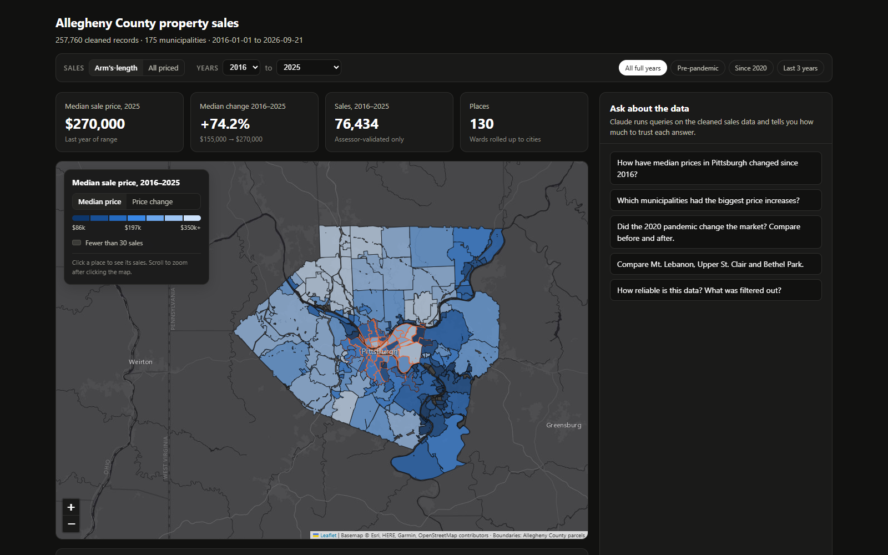
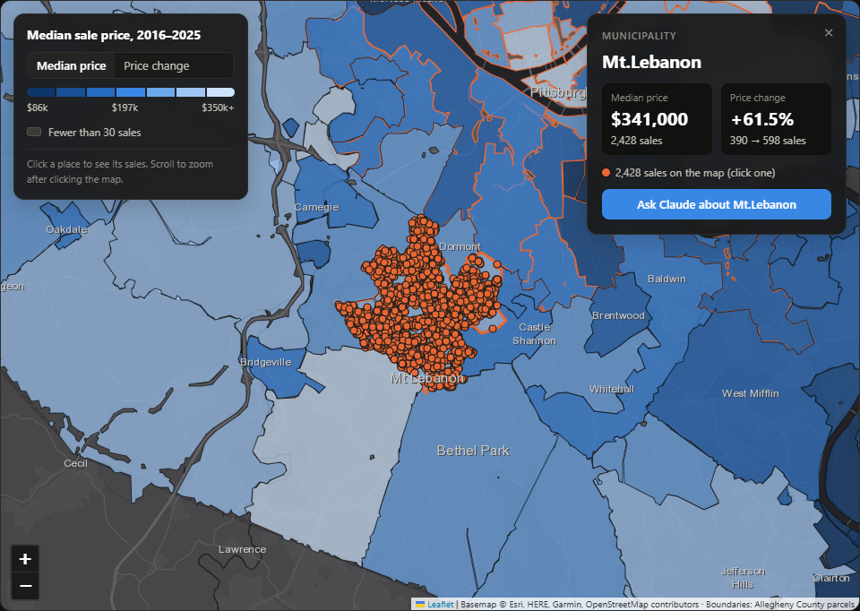
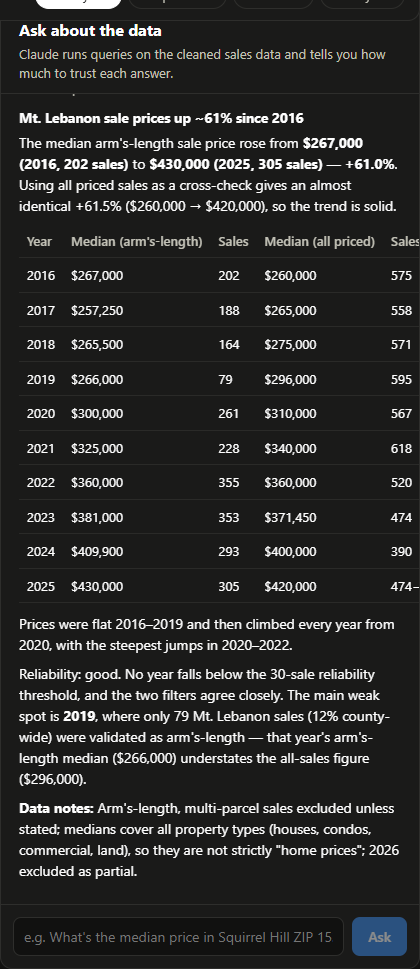
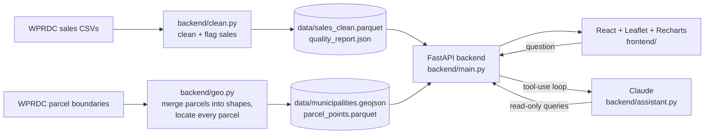

# Allegheny County Housing Sales Dashboard

**AI Horizons Pittsburgh Hackathon: Housing track**
Built by Chandra, M.S. Artificial Intelligence Systems Management, Carnegie Mellon University.

An interactive map, dashboard and AI assistant for exploring property sale prices in Allegheny County, Pennsylvania, from 2016 to 2026. Its main idea is **honesty about data quality**. Every figure says how many sales it rests on, anything built on fewer than 30 sales is flagged, and the AI assistant only answers from query results it can show you.



---

## The problem

The county publishes every property transfer, but the raw data is messy. Of **367,767** sale records from 2016–2026, almost a third are $0/$1 deeds, family transfers or duplicates. Many of the rest are sheriff sales, corporate transfers or other non-market deals. A median computed on the raw file is misleading, and one computed on a tiny town's handful of sales is noise.

This project turns that file into something people can trust:

| Stage | Records |
|---|---:|
| Raw county sale records (2016–2026) | 367,767 |
| Clean priced sales (no missing prices, sub-$10k transfers or duplicates) | 257,760 |
| Assessor-validated arm's-length (market) sales | 82,179 |

## Features

### Interactive map
- **Shapes:** all 175 municipalities, with Pittsburgh split into its 32 wards. The shapes are built from the county's 585,925 parcel boundaries, merged by municipality code.
- **Colour:** places are shaded by **median sale price** or by **price change** over the selected years.
- **Not enough data:** places with fewer than 30 sales are shaded grey, so a noisy number never looks solid.
- **Hover** shows a place's value and the number of sales behind it.
- **Clicking a place** zooms in and plots **every individual sale** as a dot. Clicking a dot shows its address, price, date and sale type.
- A details card for the selected place has an **"Ask Claude about this place"** button.



### Filters that drive every panel
- **Sale type:** assessor-validated *arm's-length* sales (the default), or *all priced sales*.
- **Year range:** from/to selects plus presets (*All full years*, *Pre-pandemic*, *Since 2020*, *Last 3 years*). Price change compares the first two years of the range with the last two, so small places have enough sales. 2026 is marked as a partial year.

### Dashboard
- **Headline figures:** latest median, change over the range, number of sales and places.
- **Trend chart:** median price over time (yearly or quarterly), comparing the county with up to two places you pick.
- **Volume chart:** quarterly sale counts.
- **Municipality table:** sortable and searchable, with low-sample badges.
- **Data quality panel:** every cleaning step and how many rows it removed, the known caveats, and validation coverage by year.

### AI Q&A with Claude
- Ask questions in plain English, for example *"Did the 2020 pandemic change the market?"* or *"What about Haysville? Is its trend reliable?"*.
- **Read-only tools:** Claude never sees the raw data. It calls five tools over the cleaned dataset (`sales_stats`, `price_change`, `top_sales`, `find_names`, `data_quality_report`), and the UI lists every query it ran.
- **Stated reliability:** every answer gives the filter and sample size behind each number, flags low-sample figures, cross-checks against all priced sales when validation coverage is thin, and ends with data notes.
- **Streaming:** answers stream in, and follow-up questions keep the conversation's context.



## Data sources

Both datasets are published by the Western Pennsylvania Regional Data Center (WPRDC):

| Dataset | Used for | Link |
|---|---|---|
| **Allegheny County Property Sale Transactions** | Every property sale: price, date, parcel ID, municipality, sale-validity code | https://data.wprdc.org/dataset/real-estate-sales |
| **Allegheny County Parcel Boundaries** | Parcel polygons, used to build municipality/ward shapes and to place each sale on the map | https://data.wprdc.org/dataset/allegheny-county-parcel-boundaries1 |

The data is **not included in this repository**. Download it and rebuild it locally as described below.

## Data quality notes and known caveats

- **Arm's-length filter:** the county gives each sale a validity code, and only code `0` ("valid sale") marks an arm's-length market sale. The dashboard and Claude use these sales by default.
- **Validation coverage changes by year:** the assessor validated **12% of priced sales in 2019** but 44–46% in 2022–2025. That's why about half the map turns grey on "price change since 2016" in arm's-length mode, and why Claude cross-checks long-run trends against all priced sales.
- **No property type:** the sales file has no property-type field, so medians mix houses, condos, commercial property and land.
- **Multi-parcel sales** (code `H`) record one price for several parcels and are excluded by default.
- **2026 is a partial year** (data through September 2026).
- **Parcel matching:** 99.87% of sales match a parcel polygon (99.99% of arm's-length sales).

## How it works



**Cleaning** (`backend/clean.py`):

| Step | Removed | Why |
|---|---:|---|
| Missing price or sale date | 2,158 | No usable price or date |
| Price below $10,000 | 107,682 | $0/$1 deeds and gifts, not market prices |
| Duplicate parcel + date + price | 167 | The same transaction recorded twice |

Each clean row keeps its sale code and gets the flags `is_arms_length`, `is_multi_parcel` and `is_non_market`.

**Map layers** (`backend/geo.py`):
- **Shapes:** parcels don't cover streets, so merging them directly leaves road-shaped gaps. Each parcel is grown by about 35 m, merged by municipality code, then shrunk back. The result is 175 clean shapes (about 0.5 MB of GeoJSON).
- **Sale locations:** one interior point per parcel, joined to sales on parcel ID.

**AI assistant** (`backend/assistant.py`):
- Runs a streaming tool-use loop with the Anthropic Python SDK (default model `claude-opus-5`, adaptive thinking).
- Uses prompt caching.
- Retries automatically on a fallback model if a request is refused (the API's server-side `fallbacks: "default"` setting).

## How Claude is used

Claude plays two separate roles in this project: one while the app was being **built**, and one while it **runs**.

### 1. Claude Code (CLI): writing the application

The application was developed in a terminal session with [Claude Code](https://claude.com/claude-code), Anthropic's command-line coding agent, working in this project folder. Chandra directed the work: choosing the data sources, deciding features and priorities, reviewing results and asking for changes. Claude Code did the hands-on engineering:

- **Data exploration:** profiled the raw WPRDC files (sale codes, price distributions, validation coverage by year) and found the 2019 coverage problem and the parcel-to-sale match rate.
- **Pipelines:** wrote the cleaning pipeline (`clean.py`) and the geometry pipeline (`geo.py`), including the parcel "grow–merge–shrink" technique that turns 585,925 parcels into municipality and ward shapes.
- **App code:** built the FastAPI backend, the React/Leaflet/Recharts frontend, the filters and the map interactions.
- **Testing:**
  - Ran the API endpoints and checked the numbers against the data.
  - Drove the app in headless Chrome (Playwright) and read the screenshots to find visual bugs, for example sale dots being hidden under the map shapes, or the sticky filter bar covering the legend.
  - Fixed what it found, including a place-name matching bug that counted *East Pittsburgh* as part of *Pittsburgh*.
- **Demo video:** built the tooling for it: a teleprompter/voice recorder, audio clean-up, a scripted screen recording, and captions.

### 2. Claude API: reasoning over the data at runtime

Inside the running app, the **Ask about the data** panel is powered by the [Anthropic Messages API](https://docs.anthropic.com/) through the official Python SDK (`backend/assistant.py`). Here Claude is the reasoning engine that turns a plain-English question into data queries and an answer you can check:

1. **Question with context:** the user's question (plus earlier turns) is sent to Claude, along with a system prompt describing the dataset and its caveats.
2. **Planning:** with **adaptive thinking**, Claude decides which facts it needs, such as place names, yearly medians and sample sizes.
3. **Tool calls:** Claude calls read-only **tools**: `sales_stats`, `price_change`, `top_sales`, `find_names` and `data_quality_report`. The backend runs them against the cleaned data with pandas and returns JSON. Claude can call several tools in parallel and go back for more, up to 8 rounds.
4. **Reasoning over the results:** Claude compares periods, checks sample sizes, cross-checks arm's-length sales against all priced sales when validation coverage is thin, and flags low-sample figures.
5. **Answer:** a short Markdown answer with the headline finding, a table and data notes, streamed to the browser. The UI shows every tool call, so each number can be traced back to a query.

The system prompt includes these rules:
- Answer only from tool results; never invent numbers.
- State the filter and sample size behind each figure.
- Flag anything below 30 sales, and note partial years.
- Remind users that prices mix property types.

**API features used:**
- **Streaming responses**, so the answer appears as it's written.
- **Prompt caching** of the system prompt and tool definitions.
- **Server-side refusal fallback** (`fallbacks: "default"`).

The model is `claude-opus-5` by default and can be changed with `CLAUDE_MODEL` and `CLAUDE_EFFORT` in `backend/.env`.

The two roles are independent. Claude Code is only a development tool and isn't needed to run the app. The Claude API is only needed for the Q&A panel. The map, charts and tables work without an API key.

## Tech stack

- **Backend:** Python, FastAPI, pandas, pyarrow, shapely, Anthropic Python SDK
- **Frontend:** React 18, Vite, Leaflet (Esri grey basemap), Recharts, react-markdown
- **AI:** Claude via the Anthropic Messages API (runtime Q&A); Claude Code CLI (development)
- **Demo tooling:** Playwright (scripted screen recording), ffmpeg (via `imageio-ffmpeg`)

## Getting started

### Requirements
- Python 3.10+ and Node.js 18+
- An Anthropic API key (for the Q&A panel)
- About 400 MB of disk space for the downloaded data

### 1. Download the data
1. **Property sales:** from https://data.wprdc.org/dataset/real-estate-sales, export the sales for 2016–2026 as CSV and save them in the project root as one file per year (`2016.csv`, `2017.csv`, …, `2026.csv`). `clean.py` reads every `20*.csv` it finds there. The columns must match the WPRDC export (`PARID`, `PRICE`, `SALEDATE`, `SALECODE`, `MUNICODE`, `MUNIDESC`, …).
2. **Parcel boundaries:** from https://data.wprdc.org/dataset/allegheny-county-parcel-boundaries1, download the CSV export (it has `PIN`, `MUNICODE` and a `dataspatial_wkb` geometry column) and save it in the project root as `parcel boundary.csv`.

### 2. Backend
```bash
python -m venv .venv
.venv/Scripts/pip install -r backend/requirements.txt        # macOS/Linux: .venv/bin/pip
cp backend/.env.example backend/.env                           # then put your ANTHROPIC_API_KEY in it

.venv/Scripts/python backend/clean.py     # builds data/sales_clean.parquet + data/quality_report.json
.venv/Scripts/python backend/geo.py       # builds data/municipalities.geojson + data/parcel_points.parquet (~4 min)
```

### 3. Frontend
```bash
cd frontend
npm install
npm run build
cd ..
```

### 4. Run
```bash
.venv/Scripts/python -m uvicorn main:app --app-dir backend --port 8000
```
Open http://127.0.0.1:8000. The API and the built frontend are served from the same port. The map's basemap tiles load from Esri, so the page needs internet access.

For frontend development with hot reload, keep uvicorn running and run `npm run dev` in `frontend/` (http://localhost:5173; `/api` is proxied to port 8000).

## API

| Endpoint | Returns |
|---|---|
| `GET /api/overview?arms_length_only=&year_from=&year_to=` | Headline figures for the selected range |
| `GET /api/trend?granularity=year\|quarter\|month&municipality=&municode=&arms_length_only=&year_from=&year_to=` | Median, quartiles and sale count per period |
| `GET /api/map?arms_length_only=&year_from=&year_to=` | GeoJSON municipality shapes with median / change / sample-size properties |
| `GET /api/sales_points?municode=&arms_length_only=&year_from=&year_to=` | Individual sales with coordinates (max 4,000) |
| `GET /api/municipalities?arms_length_only=&year_from=&year_to=` | Per-place table rows |
| `GET /api/quality` | The cleaning and data-quality report |
| `POST /api/ask` `{question, history}` | NDJSON stream of `text` / `tool` / `done` / `error` events |

## Project structure

```
backend/
  clean.py          # raw sales CSVs -> cleaned, flagged sales + quality report
  geo.py            # parcel boundaries -> municipality/ward shapes + parcel points
  analytics.py      # in-memory query layer used by the API and by Claude's tools
  assistant.py      # Claude tool-use loop (streams progress events)
  main.py           # FastAPI app (also serves frontend/dist)
  requirements.txt
  .env.example      # template; copy to .env and add your key (never commit .env)
frontend/
  src/App.jsx       # layout, filter bar, headline figures
  src/MapView.jsx   # Leaflet map: choropleth, sale dots, details card
  src/TrendChart.jsx, VolumeChart.jsx, MuniTable.jsx, QualityPanel.jsx, Chat.jsx
demo/
  record.js         # scripted screen recording of the demo (Playwright)
  record_voice.py   # teleprompter + microphone recorder for the narration
  prepare_voice.py  # trims silences and normalizes the recorded narration
  build.py          # merges screen video, narration and captions into an MP4
  narration.json    # the demo script
docs/               # screenshots used in this README
```

## What's real and what's not

Everything described above is working and uses real data. Nothing is mocked. Current limitations:

- It runs locally and isn't deployed yet.
- There's no property-type breakdown, because the sales file doesn't include one.
- 2026 is a partial year.
- Claude's answers are grounded in tool results, but in testing it once drew a wrong conclusion from correct numbers, so read its answers critically.
- The app was built with **Claude Code** as the coding assistant (see [How Claude is used](#how-claude-is-used)).

## Next steps

- Deploy it publicly.
- Add property types (house / condo / land) by joining the county's property assessment data.
- Let people compare their own home with its neighborhood.

## Acknowledgements

- Data: [Western Pennsylvania Regional Data Center](https://data.wprdc.org/) and Allegheny County.
- Basemap: Esri, HERE, Garmin, © OpenStreetMap contributors.
- AI: [Claude](https://www.anthropic.com/claude) by Anthropic.
